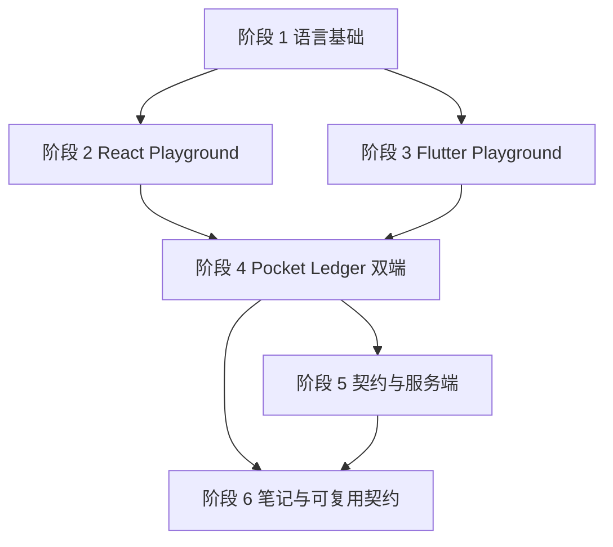

# 学习路线

这份文档规定 `frontend-lab` 的阶段顺序和完成标准。仓库仍按既定路径推进：

**基础知识（Fundamentals）→ 独立实验（Playground）→ 完整案例（Projects）→ 总结与沉淀（Docs）**

顺序参考 [roadmap.sh](https://roadmap.sh/) 及其开源内容仓库 [nilbuild/developer-roadmap](https://github.com/nilbuild/developer-roadmap)。roadmap.sh 用来回答「下一步学什么、主题怎样衔接」；本仓库用来回答「代码放在哪、怎样用 Pocket Ledger 验证学会了」。

对应的外部路线：

| 本仓库阶段 | 参考路线 |
| --- | --- |
| Web 语言与界面基础 | [Frontend](https://roadmap.sh/frontend)、[JavaScript](https://roadmap.sh/javascript)、[TypeScript](https://roadmap.sh/typescript) |
| React 实验 | [React](https://roadmap.sh/react) |
| Flutter 实验 | [Flutter](https://roadmap.sh/flutter) |
| 案例后端 | [Go](https://roadmap.sh/golang)、[PostgreSQL](https://roadmap.sh/postgresql)、[API Design](https://roadmap.sh/api-design) |

roadmap.sh 的图例在这里收成四种标记：

| 标记 | 含义 |
| --- | --- |
| 推荐 | 本仓库的默认路径，先做完 |
| 备选 | 同一问题的另一种实现。推荐路径能跑通之后，再挑一个对照 |
| 后置 | 产品和当前实验还没用到它，先不学 |
| 随时 | 顺序不严格，做实验碰到再补 |

每个专题走 README 里的闭环：理解、实验、验证、迁移到 Pocket Ledger、写一则短总结。完成标准是能独立解释并复现，不是把上表里的路线节点全部勾完。

## 总览

两条客户端交错推进，按同一种能力成对练习：React 做一个专题，Dart 或 Flutter 做对应专题，再把结果用到记账的同一块功能上。服务端等到双端的页面和数据模型稳定后再开始。

| 阶段 | 目的 | 代码位置 | 完成标志 |
| --- | --- | --- | --- |
| 1. 语言基础 | 能读懂并手写后续实验要用的语法 | `fundamentals/` | 空安全、函数、集合、类型、异步各有一个可运行示例 |
| 2. React | 用现代 React 做可交互界面 | `playground/react/` | 六个专题都能本地跑，并说明状态放在哪一层 |
| 3. Flutter | 用 Widget 树完成对应的移动端交互 | `playground/flutter/` | 六个专题都能本地跑，并能解释布局约束 |
| 4. Pocket Ledger | 同一业务在 Web 和 Mobile 各做一版 | `projects/pocket-ledger/` | MVP 页面可走通，规则两端一致，数据先用 Mock |
| 5. 契约与服务端 | 用真实 API 替换 Mock | `projects/pocket-ledger/server/`、`shared/api-contracts/` | 一个资源的读写经过 OpenAPI 与 PostgreSQL |
| 6. 沉淀 | 留下可迁移的决策，而不是只留代码 | `docs/notes/`、`shared/` | 每个已完成专题有复盘；共享目录只收已经重复出现的契约 |

## 阶段 1：语言基础

Web 侧默认已经会用 HTML 写结构和用 CSS 做简单布局。语义化表单、响应式和基础可访问性放到 React 的组件与表单实验里复核，不单独开一条前端职业路线。Git 作为日常工具使用。

### JavaScript

目录：`fundamentals/javascript/`。范围对齐 [JavaScript 路线](https://roadmap.sh/javascript) 的入门部分，够写 React 即可。

- 值与引用、作用域、闭包
- 数组与对象的常用变换：`map`、`filter`、展开
- 模块：`import` / `export`
- 异步：`Promise`、`async` / `await`、`fetch`
- DOM 只保留到能说明 React 替你做了什么

完成标志：不查资料写出「请求一份 JSON，并按条件筛成新数组」的小脚本。

### TypeScript

目录：`fundamentals/typescript/`。对齐 [TypeScript 路线](https://roadmap.sh/typescript) 里写应用会立刻碰到的部分。

- 基础类型、数组、对象、函数参数与返回值
- `type` 与 `interface`、联合类型、可选属性
- 泛型的日常用法，例如 `Array<T>` 和组件 props
- 收窄：`in`、判别联合、`unknown` 优于 `any`

工具类型、条件类型和复杂 `tsconfig` 标为后置，等 Pocket Ledger 的数据模型需要时再补。

完成标志：给一个流水对象写出类型，并在接收未知 JSON 时把结果收窄成该类型或错误。

### Dart

目录：`fundamentals/dart/`。这是 Flutter 的先修，主题顺序对齐 [Flutter 路线](https://roadmap.sh/flutter) 开头的 Dart 基础。官方阅读顺序见 [Learn Dart](https://dart.dev/learn) 和 [Introduction to Dart](https://dart.dev/language)。

推荐先做：

1. 变量：`var`、`final`、`const`，以及 `?` 空安全
2. 内置类型：`String`、`List`、`Set`、`Map`、Record
3. 函数：位置参数、命名参数、`required`、箭头函数
4. 控制流，以及 `if` 条件必须是 `bool`
5. 类：构造函数、命名构造、getter、`enum`
6. 异步：`Future`、`async` / `await`

`Stream`、Isolate、代码生成标为后置。练习可以先放在 [DartPad](https://dartpad.dev)（国内可用 [dartpad.cn](https://dartpad.cn)），稳定后再收进 `fundamentals/dart/`。

完成标志：写出一个带空安全的模型和一个返回 `Future` 的函数，并能说明 `_` 前缀的库级可见性。

## 阶段 2：React Playground

先修是阶段 1 的 JavaScript 与 TypeScript。[React 路线](https://roadmap.sh/react) 要求先完成 JavaScript 入门主题；本仓库同样遵守。

工程基线是 Vite + React + TypeScript。类组件、高阶组件和 render props 标为随时：读旧代码时能认出来即可，新实验用函数组件。

相近示例共享一个 Vite 工程，用路由或示例入口切换，不必每个知识点一个仓库。

| 目录 | 要掌握 | 推荐 | 备选 / 后置 | 迁到 Pocket Ledger |
| --- | --- | --- | --- | --- |
| `01-components/` | JSX、props 与 state、组合、条件渲染、列表与 key、事件 | 函数组件 | 类组件（随时，只作阅读） | 金额、分类、空状态等展示组件 |
| `02-hooks/` | `useState`、`useEffect`、`useRef`、自定义 Hook | 先写直白的 state 和 effect | `useMemo`、`useCallback` 在测到开销后再用 | 列表筛选、副作用清理 |
| `03-forms/` | 受控输入、校验、错误展示、提交状态 | 先用组件 state | 表单变复杂后再引入 React Hook Form；跨端规则用 Zod | 记一笔 |
| `04-routing/` | 路由表、参数、嵌套布局、未知路径 | React Router | TanStack Router | 流水、统计、设置等页面切换 |
| `05-state-management/` | 局部状态、状态提升；分清服务端状态和客户端状态 | 服务端状态用 TanStack Query；跨页面客户端状态需要时再用 Zustand | Context 适合低频依赖；Redux、Jotai、MobX 后置 | 账本数据与界面偏好分开存放 |
| `06-data-visualization/` | 由数据生成图表，处理空数据与极端金额 | 选一个图表库并讲清数据从哪来 | 动画库后置 | 收支汇总 |

样式走 Tailwind CSS。重复出现的交互再抽到 shadcn/ui，不在第一个组件实验里引入整套组件库。测试在表单和状态专题用 Vitest 与 React Testing Library 覆盖主要交互；端到端测试后置。

完成标志：每个目录有可运行示例；能讲清某份数据是组件状态、Zustand 还是 TanStack Query，以及为什么。

## 阶段 3：Flutter Playground

先修是阶段 1 的 Dart。主题顺序对齐 [Flutter 路线](https://roadmap.sh/flutter)：环境与 Widget 在前，状态、网络和动画在后。

| 目录 | 要掌握 | 推荐 | 备选 / 后置 | 迁到 Pocket Ledger |
| --- | --- | --- | --- | --- |
| `01-widgets/` | Widget 树、Stateless 与 Stateful、组合、Material 3 | 官方 Material Widget | Cupertino 只在需要平台外观时再看 | 流水行、金额文本、空状态 |
| `02-layout/` | 约束向下、尺寸向上；`Row`、`Column`、`Flex`、滚动、安全区 | 先用官方布局 Widget 手写 | 响应式断点在页面变宽时再加 | 手机上的列表与记一笔表单 |
| `03-navigation/` | 页面栈、路径、参数、未知页面 | 理解 `Navigator` 之后使用 go_router | 多套路由方案不并行学习 | 与 Web 对应的页面入口 |
| `04-state-management/` | 局部 `setState`，再把跨页面状态交给可测试的容器 | Riverpod | Provider、BLoC、Redux、GetX 后置 | 与 Web 相同的账本规则，不同的状态容器 |
| `05-networking/` | 异步请求、JSON 建模、加载 / 空 / 错误三态 | 先 Mock，再用 `package:http` 调用同一份契约 | Dio 在需要拦截器或统一错误转换时引入 | 读写流水 |
| `06-animations/` | 隐式动画、页面过渡 | 短动画服务提交和切换反馈 | `AnimationController`、Hero 后置 | 记一笔成功的反馈 |

完成标志：每个目录能在模拟器或设备上跑；能解释一次布局为什么溢出，以及一次网络失败时界面如何变化。

## 阶段 4：Pocket Ledger

进入功能开发前，先在 `projects/pocket-ledger/docs/` 写清 MVP。本路线只规定要回答的问题，不在这里定死字段：

- 第一版有哪些页面，每个页面让用户完成什么
- 核心对象有哪些，金额、日期、分类、账户之间是什么关系
- 哪些规则 Web 和 Mobile 必须一致
- Mock 数据的形状，以及以后要变成哪些 HTTP 资源

建议第一版只覆盖一条闭环：看余额或汇总、浏览流水、记一笔、按分类查看。图表使用阶段 2 的可视化实验。认证、多用户、同步冲突和系统级通知后置。

实现约定：

- Web 放在 `projects/pocket-ledger/web/`，Mobile 放在 `projects/pocket-ledger/mobile/`
- 两端各自实现界面，共享的是业务规则和稍后写入 `shared/api-contracts/` 的接口契约
- `projects/` 不导入 `playground/` 的代码
- 前期使用 Mock，页面能走通再接阶段 5

完成标志：同一条流水可以在两端创建并再次看到；非法金额、空列表和请求失败都有明确界面。差异写进 `docs/notes/`。

## 阶段 5：契约与服务端

双端 MVP 用 Mock 走通之后再开始。目标对齐 [Go 路线](https://roadmap.sh/golang)、[PostgreSQL 路线](https://roadmap.sh/postgresql) 和 [API Design 路线](https://roadmap.sh/api-design) 的入门段，范围停在 Pocket Ledger 的一个资源。

推荐顺序：

1. HTTP 方法、状态码、资源路径、JSON 请求与响应
2. 用 OpenAPI 描述已经在两端用过的 Mock
3. Go 的包、结构体、错误处理和 `net/http`
4. PostgreSQL 的表、主键、查询和一次事务
5. 一个资源的创建与读取，两端改为调用这个 API

Web 框架、ORM、分页、认证和权限标为备选或后置：先知道标准库和 SQL 各自解决什么，再决定是否引入。GraphQL、消息队列、网关和多服务拆分不在本案例内。

完成标志：`shared/api-contracts/` 有一份与实现相符的 OpenAPI；Web 和 Mobile 通过它读写同一条 PostgreSQL 中的数据。

## 阶段 6：沉淀

贯穿全程，每个完成的专题只留有用的记录。

- 实验观察写在该专题的 `notes.md`
- 跨 React 与 Flutter 的差异、以及技术选型原因写在 `docs/notes/`
- 设计令牌和 API 契约在两端真的重复之后再放进 `shared/`
- 出现第二份复制代码之前，不建 Monorepo 公共包

## 当前进度

- 仓库定位、目录和本路线已经确定
- 第一个产品案例确定为 Pocket Ledger
- 下一步是 `fundamentals/dart/`：变量与空安全、函数、集合、类、`Future`
- Dart 的类和异步能写下来之后，初始化 `playground/react/` 并完成 `01-components/`
- Flutter Playground 在 Dart 先修完成后再初始化，从 `01-widgets/` 开始
- Pocket Ledger 的页面和数据模型在两端第一次实现「记一笔」之前写完

## 参考

- [roadmap.sh](https://roadmap.sh/)
- [developer-roadmap 仓库](https://github.com/nilbuild/developer-roadmap)
- [Frontend](https://roadmap.sh/frontend)、[JavaScript](https://roadmap.sh/javascript)、[TypeScript](https://roadmap.sh/typescript)、[React](https://roadmap.sh/react)
- [Flutter](https://roadmap.sh/flutter)
- [Go](https://roadmap.sh/golang)、[PostgreSQL](https://roadmap.sh/postgresql)、[API Design](https://roadmap.sh/api-design)
- [React 文档](https://react.dev/)、[TypeScript 文档](https://www.typescriptlang.org/docs/)、[Dart 文档](https://dart.dev/learn)、[Flutter 文档](https://docs.flutter.dev/)
